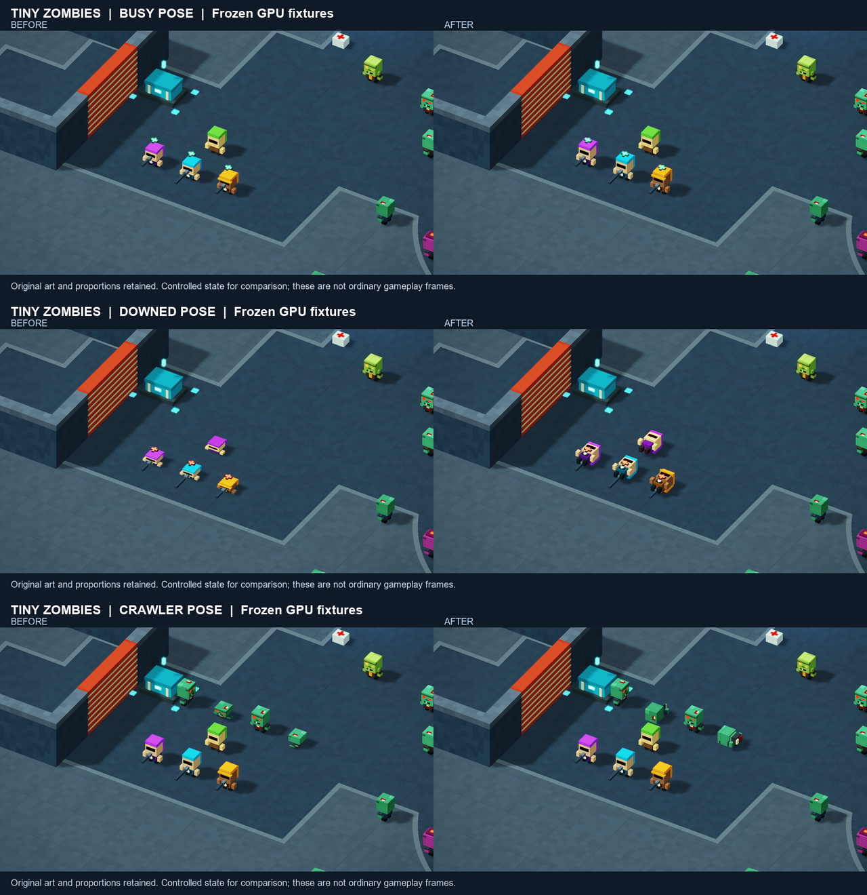

# Character proportions and slow downed movement

Characters retain their authored dimensions while healing, reviving, incapacitated or crawling. Busy squad members keep their upright size; low actors rotate intact cuboids instead of compressing the entire model on Y. The downed player can move at a fixed **0.60 m/s**, using the existing normalized input and wall/door collision path. Incapacitation cancels a residual dash and blocks new dash and grenade actions. Healthy movement, downed pistol, bleedout, revival and defeat rules remain unchanged.

The final runtime changes only the presentation `boxes` shader, the player movement block in `begin`, and crawler-specific geometry in the `zombie3` ray helper shared by `aim3` and `bullet3`. Authored art tables, palettes, animation offsets, SFX, counts, spawning, objective progression and all host code remain intact. Crawler ray cuboids now follow the same rigid transform as their visible body; non-crawler ray geometry and movement collision are unchanged.

Baseline: `c28921129fad8a4b12dfc647757302f406841943`, HTML SHA-256 `fedee3e5054b56841bda85903d261cb740e955a289a4e5ddcfc6d17b67f76192`.

Qualified final HTML: **398,561 bytes**, SHA-256 **`42d7d28e07ed2a80d64d274b374f7effbbce06c36da390af42cf88bd0e19f20f`**. The original uploaded V9 is preserved unchanged. All 43 approved audio files retain their hashes and 736,350 total bytes.

## Source and CPU qualification

The checks form a byte-preservation chain through three separately identified source checkpoints:

1. [Proportions](character-proportions-cpu.json): 37,544 geometry cases, including 28,896 exactly unchanged upright cases. Only presentation changes from the released baseline.
2. [Downed crawl](downed-crawl-cpu.json): 432 speed-cap cases, 432 healthy-movement comparisons of 60 ticks each, three timesteps, 25 authored doors open/closed, walls/corners/sliding, seven guards, host input/reset, revive and bleedout checks. Only the movement block changes from the proportion checkpoint.
3. [Crawler alignment](crawler-pose-alignment-cpu.json): 36,288 broad-phase containment cases over four facings and authored motion ranges. Only `zombie3` changes from the crawl checkpoint; presentation, collision, art and damage helpers remain exact. Minimum tested crawler ground clearance is 0.07 m.

These scalar source/geometry tests do not establish WGSL compilation or GPU behavior. Reproduce using the baseline HTML from `c289211`, the proportion checkpoint from `e06b43b`, the crawl checkpoint from `8a4589e`, and the final `index.html`. Preserve LF bytes when extracting files from Git:

```text
node tools/check_character_proportions.cjs baseline.html proportions.html
node tools/check_downed_crawl.cjs proportions.html crawl.html
node tools/check_crawler_pose_alignment.cjs crawl.html index.html
```

## Windows GPU and visual qualification

Chrome 155.0.8059.41, NVIDIA RTX 5070 Ti, driver 32.0.15.9186 / 591.86, 1280x720, 2,048 zombies and 32,768 particles. Fresh isolated headless profiles were used. The approved GPU slot lasted 20:29:36–20:43:00 UTC on October 15, 2026, within its 15-minute cap. All owned processes closed; all four session cleanup receipts report no GPU fault. No driver or security settings were changed.

Both exact served Document hashes passed, followed by frame-zero shader initialization and a one-frame gate. [Machine-readable summary](character-windows-summary.json) and [recorded results](character-browser/) retain the evidence.

Controlled GPU fixtures dispatch the real compiled `begin`, `buddy` and `boxes` pipelines against actual world occupancy. They are explicitly initialized states, not naturally earned gameplay:

- Five seconds of downed input travels 2.99950 m and clears a residual dash. Closed doors block and open doors allow movement. Pause and completed-state fixtures do not move.
- The existing revive path restores 60 HP and clears incapacitation.
- 168 of 168 rays aimed through the 42 rigid crawler cuboids across four facings hit. The former ray helper hits 92 of those new-pose targets, demonstrating why it could not be retained after changing the visual pose; this is not a claim that the previous release missed its own old silhouette.
- Frozen standing, busy, downed and crawler frames were inspected. Heads and limbs retain dimensions, low actors clear the floor, and weapon placement remains readable. The larger lying silhouette is visual; the existing movement footprint remains unchanged.



Matched normal-play recordings use seed 73129 and the original keyboard/mouse handlers: leave shelter, aim/fire, advance, reload, then let combat continue. No actor, HP, position or objective edits occur after reset. Both runs show squad activity and a revival. Neither naturally downs the player; the downed movement/pose evidence is the separate fixture suite. Both run for approximately 60 simulation seconds. Median FPS is 60.00 for each. Observed GPU median/p95 is 2.82/3.93 ms before and 2.62/3.54 ms after; health ends at 58/79. Timing and atomic order produce different combat trajectories, so these are observations, not a controlled performance improvement claim. Captures are silent because browser audio output was muted; the original WebAudio host ran.

The diagnostic helper needed corrections for an oversized state copy, a startup-port race, a 360-vs-300-tick assertion mismatch, and a generated JavaScript newline. Affected attempts stopped and closed their owned profiles. These were helper errors, not WebGPU/device failures. The final exact candidate passed the corrected fixtures and gameplay checks. Local raw attempts remain preserved.

For a coordinated rerun, use the supplied `check.mjs`, `characters-mode.mjs` and `alignment-eval.js` with exact baseline/candidate HTML, matching SHA manifest, assets, a fresh isolated browser profile and Windows fault monitor. Run `boot` and `gate` before `characters <variant> fixtures`, `poses`, `alignment` or `natural2`. Acquire the shared GPU slot first and stop on faults or loss of frame progress. Do not run these fixtures against the original V9 or an existing user browser profile.

## Review and release

This is an implementation-owner review, not an independent second review. The final source diff was inspected and the three checks establish the intended scope. The actual GPU tests resolve the crawler hit-alignment issue discovered during visual review. No release blocker remains within this bounded qualification. It is a single-seed, single-adapter check, not a full campaign or extended soak; natural player downing and respawn were not captured in these one-minute clips.

Merge only the reviewed PR head. Verify the deployed HTML and each of the 43 audio assets against their qualified hashes. A rollback should revert the PR's merge commit with mainline parent 1 and deploy that new commit; do not reset or force-push main.
