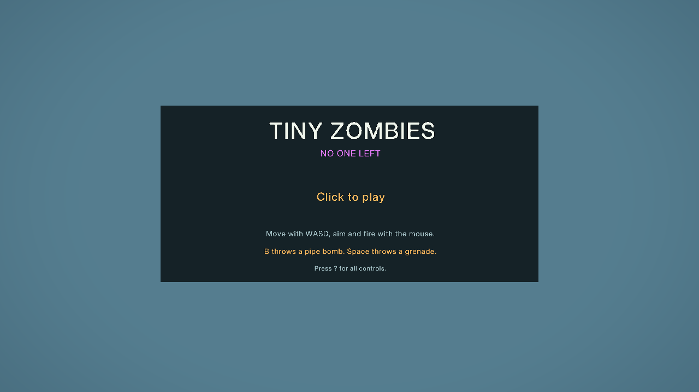
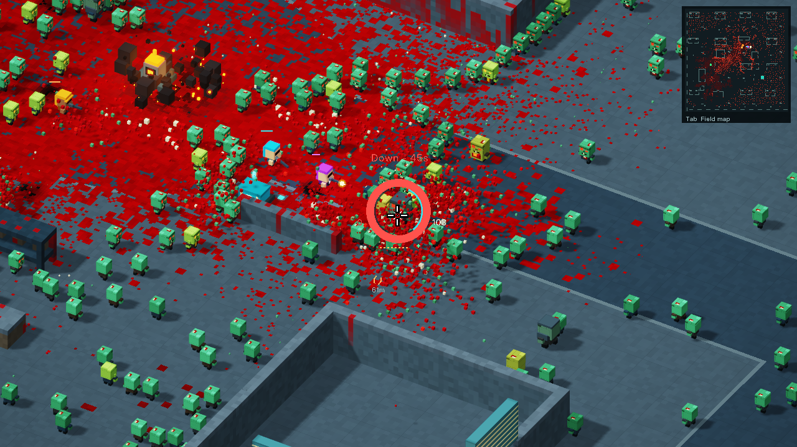

# New-campaign checkpoint lifecycle

Pressing N previously reset the run to leg 1 and cleared upgrades while retaining the old checkpoint. Reloading then offered Continue and restored the old leg 3 campaign. A reward choice queued before N could also advance the reset campaign directly to leg 2.

N now clears the checkpoint in memory and localStorage immediately, before the next frame, and cancels queued advancement. Reward keys and pointer clicks ignore stale UI while a new world is pending. The existing final-leg advance path uses the same clear helper. If storage rejects deletion, the in-memory checkpoint still clears and diagnostics record the storage error; the game cannot guarantee durable deletion when the browser denies storage access.

Continue still resumes valid leg 2/3 checkpoints. Backspace still retries the current leg with its carried upgrades and checkpoint. Completion retains the current checkpoint for retry until the player explicitly starts another campaign. Practice/lab transitions and unrelated storage are preserved. The checkpoint parser and format remain unchanged.

## Scope and reproduction

Baseline is PR9 merge `1debc6cdf7b4a5cb0d6772f3e20d849f890c20eb`, HTML SHA-256 `42d7d28e07ed2a80d64d274b374f7effbbce06c36da390af42cf88bd0e19f20f`. The qualified candidate is **398,767 bytes**, SHA-256 **`517446909154b42d695fc14717cbfdb1cdb7482a970f1b12cbdde4051f3b5e58`**.

The runtime diff is five added/four removed host lines. All shader sources are exact, preserving the character proportions, downed crawl, collision, AI, director, art and rendering. All 43 recorded SFX clips retain their approved hashes and 736,350 total bytes. The original uploaded V9 remains unchanged. Source backups and earlier campaign audits remain local.

[Focused CPU checks](checkpoint-lifecycle-cpu.json) reproduce both defects in PR9 and pass 28 candidate cases. They execute the actual parser, input handlers and frame transition/reset code with GPU operations forbidden. They cover title/active/paused/help/downed/dead/upgrade/win states, immediate reload before the reset frame, queued choices, pointer input, repeated N, seed wrapping, Continue, retry, leg transitions, final completion, malformed saves and storage failures. These are explicit host-state fixtures, not campaign-play claims.

```text
node tools/check_checkpoint_lifecycle.cjs PATH_TO_PR9_HTML index.html report.json
```

## Windows browser qualification

Chrome 155.0.8059.41, NVIDIA RTX 5070 Ti, driver 32.0.15.9186 / 591.86, 1280x720, 2,048 zombies and 32,768 particles. Fresh isolated profiles and Windows GPU fault monitoring protected existing browser sessions and saves. [Summary](checkpoint-windows-summary.json), [test harness and results](checkpoint-browser/).

Both exact Document-response hashes passed, followed by shader initialization and a one-frame gate. The browser reproduced the original stale Continue and queued-choice bugs. The candidate passed 19 recorded checkpoints covering actual key/pointer events, WebGPU frame/reset work, localStorage and real page reloads. Saved data and won/dead readbacks were explicitly initialized fixtures. Continue/reload, death/retry, leg 2/3 advancement, final completion, repeated N, paused reset and interrupted event sequences passed.

The helper was corrected to drain pending frames/readbacks and register its diagnostic bootstrap on the CDP session that owns reloads. Earlier attempts are preserved locally. Every session closed all owned processes and released the GPU with no device loss or Windows GPU fault. A final `Page.getResourceContent` check could not read an uncached response; the initial `Network.getResponseBody` identity and unchanged served files provide the qualification identity. Public deployment must additionally pass fresh live response hashing and browser behavior checks.



## Bounded pacing observation

One normal seed-73129 route used original movement, aiming, firing, dash, grenade and interaction controls. No positions, HP, actors or objectives were edited after its clean start. Automated steering reached 15 waypoints, rescued Violet, activated Relay A, collected the cell and activated Relay B. The player was naturally downed at 52.32 seconds on the approach toward extraction; median FPS was 60.00. This is an aggressive forward route, not a completed campaign or proof that stopping to heal cannot work.

The next concrete pacing weakness to investigate is **pressure carrying continuously through the relay/cell objective chain**. FADE began at 11.22 seconds and never returned to RELAX before the player went down. Health was 100 then, 86 at Relay A (22.22 s), 59 at the cell (38.22 s), 38 at Relay B (49.13 s), and 0 before extraction. The global awake-enemy contribution can floor intensity at 0.62, above the 0.34 recovery threshold; source inspection suggests it is worth distinguishing nearby pressure from trailing/global alertness before tuning recovery. This is a causal hypothesis, not a demonstrated fix. A bounded comparison with a deliberate regroup/cover stop after Relay A is the next useful test. No pacing or map changes are part of this release.



## Review and rollback

This is an implementation-owner review, not an independent second review. The source change is confined to the checkpoint clear helper and pending-transition input behavior. CPU preservation checks and actual browser lifecycle checks cover the reported bug and adjacent interruption paths. Merge only the reviewed PR head. Verify Pages CI against the resulting merge commit, public HTML and every SFX hash, then run the isolated live lifecycle smoke. If rollback is needed, revert the merge with mainline parent 1; do not reset or force-push history.
