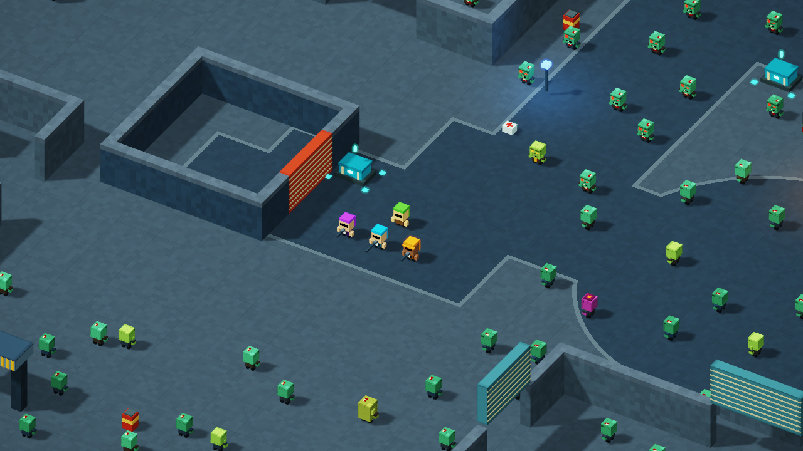
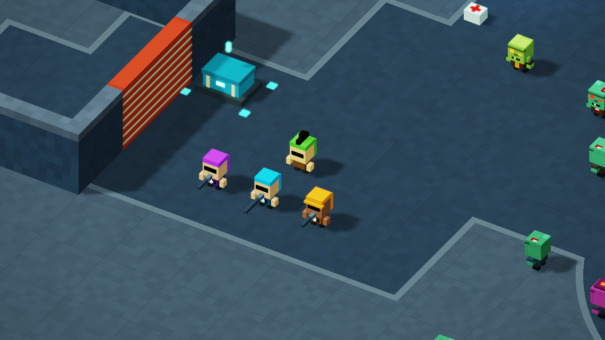
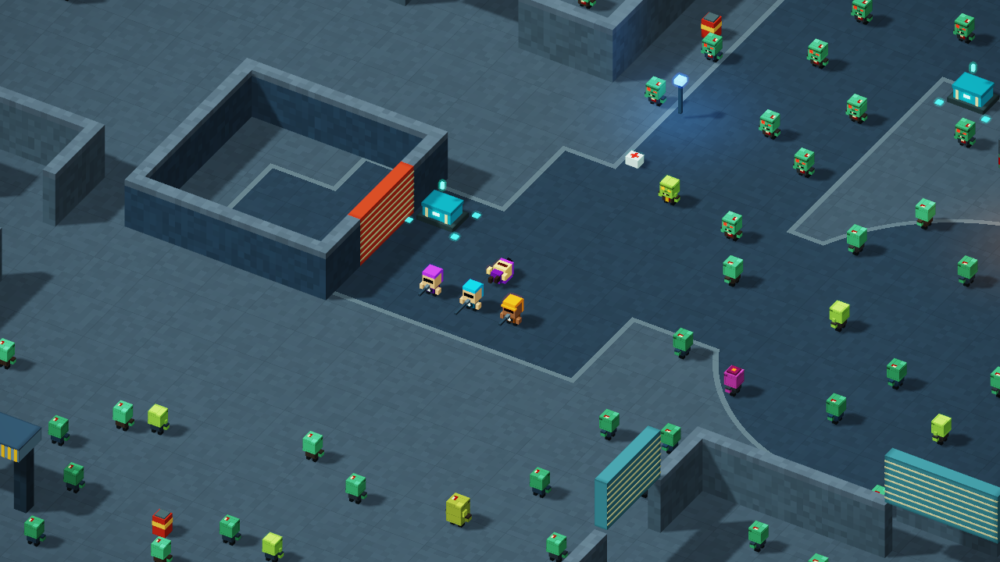

# Player mohawk

The main character now has a narrow, stepped dark mohawk. Three cuboids sit on the existing head and use the same rigid yaw and prone transforms as the body. The crest is visible at the default zoom of 34; the detail view at zoom 16 makes its shape easier to inspect. Squad members and zombies retain their existing appearance.





The runtime diff is one inserted line in the player-only branch of `boxesShader.model`. No existing line changes. Body proportions, collision, hitboxes, movement, downed crawl, revival, AI, level geometry, difficulty, counts, controls, text and audio are preserved. The addition uses the existing voxel dimensions and palette; it adds no texture, external asset or extra pass.

Baseline: PR10 merge `ee699d11dbb60cb2f2f59c90d67e1825ed5be242`, HTML SHA-256 `517446909154b42d695fc14717cbfdb1cdb7482a970f1b12cbdde4051f3b5e58`. Candidate: **399,012 bytes**, SHA-256 **`f4fada3a7b8f97b9d6caca470371fdd722f9392d2ed9c09968d2f69c4a2f9397`**.

## Qualification

[Source preservation](source-preservation.json) confirms that removing the single insertion yields the exact prior release bytes. All 43 recorded audio clips retain their approved hashes and 736,350 total bytes. The original uploaded V9 remains unchanged and was not launched.

```text
node tools/check_player_mohawk.cjs PATH_TO_PR10_HTML index.html report.json
```

[Windows results](windows-summary.json): Chrome 155.0.8059.41, NVIDIA RTX 5070 Ti, driver 32.0.15.9186, 1280x720, 2,048 enemies and 32,768 particles. The isolated profile loaded the exact candidate response, initialized its shaders and passed a one-frame gate before further work. Windows GPU fault monitoring and device-loss checks reported no fault; all owned processes closed and the GPU lease was released.

The 24 matched pose comparisons cover standing in four directions, moving, aiming left/right, downed front/side, crawling front/side and a revived pose, at default and detail zoom. Each before/after pair renders the same frozen GPU state with the prior or candidate boxes shader. Exact cuboid multiset comparison found three additions and zero removals in every case. All previous cuboid bytes, including squad and zombie geometry, matched. UI was suppressed equally for these art comparisons. These are explicit pose fixtures, not naturally occurring gameplay events.

The original key and pointer handlers also ran for 7.80 simulation seconds with 40 recorded samples, movement and left/right aiming. No positions, HP or actors were written after reset. The player moved from the shelter spawn to approximately (-60.81, 54.18) at 100 HP. The initial shelter wall partly occludes that short route; the matched screenshots above and below provide the unobscured art evidence.

Six additional explicit GPU-state fixtures exercised the actual compiled movement and buddy pipelines: crawl at 0.6 m/s, closed-door collision, open-door passage, paused and finished states, and buddy revival to 60 HP with the downed timer cleared. Attempted dash did not accelerate the downed player. These fixtures establish preserved mechanics; the revived screenshot is a separately configured visual pose.





The [pose and controls module](pose-and-controls-harness.mjs) records the exact comparisons and uses the local bounded CDP harness callbacks. Raw profiles, full source backups and unrelated audits remain local.

## Review

This is an implementation-owner review, not an independent second review. The preservation check and exact rendered-cuboid comparisons support the player-only scope. The render-only addition does not require retuning gameplay. Merge the reviewed PR head, then verify the Pages build for the merge commit, hosted HTML/audio hashes and an isolated live smoke. If rollback is needed, revert the merge with mainline parent 1; preserve history.
