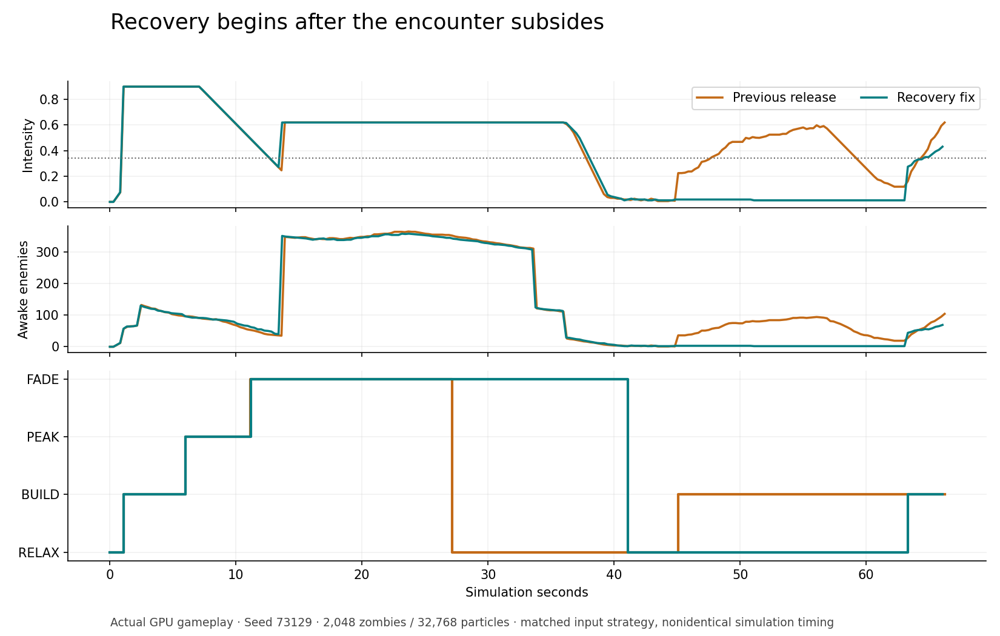

# Recovery after combat settles

Status: qualified on the leased Windows RTX 5070 Ti. Exact runtime commit `11d15850c64068dde8158539f70adbedc8c34dc8` passed the CPU and GPU checks below without further runtime changes. The isolated browser, server and monitor closed with zero GPU faults. The GPU lease was released at **2026-10-15 19:07:43 UTC** for Jet's remaining work.

Tiny's released director leaves FADE after 16 seconds even when squad intensity remains at its maximum. Its 17–24-second recovery period can therefore expire during the same fight, after which normal enemy replenishment resumes. Renewed pressure or an objective alarm during recovery also consumes that timer.

The candidate requires three continuous seconds below the existing 0.34 intensity threshold, with no active alarm, before entering recovery. Renewed pressure or an alarm during recovery returns the director to FADE and resets that calm interval. Once calm returns, the existing recovery duration starts again. Automatic replenishment stays suppressed during FADE/RELAX; forced alarms retain their existing override. Existing enemies remain active throughout.

The runtime diff is three added lines and one removed line inside the existing mission director block. It reuses the phase timer and adds no buffers, dispatches, per-enemy work or loops. BUILD/PEAK timing, the movement-based recovery exit, intensity calculation, objective logic, population settings, art, audio and controls remain byte-equivalent outside that block.

## Reference grounding

The actual [DEAD ENDS](https://tront.xyz/deadends/) source was inspected at SHA-256 `209a9d39f79649304c278ed229a0fcba52c7a610ce6c7113cbd048c46f82837e`, lines 1038–1100. It transitions from FADE to RELAX only at low intensity, without Tiny's 16-second escape. It pauses automatic waves/specials during those phases while preserving forced events. Its actual running preparation/doorway behavior was inspected in the preceding batch; this batch's director evidence is source inspection, not a new reference gameplay run.

Valve's [The AI Systems of Left 4 Dead](https://cdn.cloudflare.steamstatic.com/apps/valve/2009/ai_systems_of_l4d_mike_booth.pdf), Michael Booth, PDF pages 80–82, describes Peak Fade as allowing the current fight to finish without spending the following Relax period. This candidate applies that principle to Tiny's existing director. The continuous calm timer and interrupted-recovery reset are Tiny-specific choices, not a claim to reproduce every DEAD ENDS or L4D rule.

## Exact identities

- Released baseline: `d72ef66ddd988b7a7e760a40525436cfcc73f213`, 397,543-byte HTML, SHA-256 `6a8b47bcce3eb65b236240ffc1be9d9052b5ab6ab026089405566fb63bea4572`.
- Candidate: 397,717-byte LF HTML, SHA-256 `fedee3e5054b56841bda85903d261cb740e955a289a4e5ddcfc6d17b67f76192`.
- Exact baseline/candidate snapshots and full CPU trace are preserved in the local task's `encounter-pacing/` directory.
- Uploaded V9 remains unchanged at 368,656 bytes, SHA-256 `787cdb9b13b91e27313e550826580e4030ce314fb571299ec171ddf051f99349`. It was not launched.

## CPU evidence

[Executable check](../tools/check_recovery_pacing.cjs) extracts the exact current mission WGSL director block, transcribes only unsigned numeric suffixes and one atomic increment, and executes its scalar control flow with controlled inputs. It parses the full host JavaScript and verifies that only `mission5` changes and that all HTML outside the director block is identical. It does not compile WGSL, simulate enemies/perception, execute GPU atomics, or establish float32 timings or performance.

Fourteen scenarios, twelve timestep/RNG boundary cases, a deterministic repeat, and pause checks pass. With the controlled RNG sample 0.5 and 1/60-second steps:

| Controlled scenario | Released baseline | Candidate |
| --- | --- | --- |
| Maximum pressure for 60 seconds, starting in FADE | Recovery at 16 s; automatic replenishment allowed at 36.5 s | Remains in FADE throughout |
| Maximum pressure ends at 40 seconds | Replenishment already resumes at 36.5 s | Recovery begins at 46.3 s; replenishment allowed at 66.8 s |
| Recovery interrupted by pressure from 2–7 s | BUILD at 12.5 s | FADE at 2 s; fresh recovery at 11.28 s; BUILD at 31.78 s |
| Recovery interrupted by an alarm from 2–12 s | BUILD at 12.5 s | Alarm override retained; fresh recovery at 15 s; BUILD at 35.5 s |
| Player advances 18 m during quiet recovery | BUILD at 7.02 s | Same |

Other checks cover intermittent calm, a downed survivor, sustained and cleared awake-crowd counts, normal timeout, preparation, lab, not-started/completed runs, and zero-delta pause. The twelve boundary cases use timesteps 1/120, 1/60, 1/30 and 0.1 seconds and controlled RNG samples 0, 0.5 and 0.999. Expected durations allow one simulation step of threshold rounding.

[Machine-readable summary](recovery-pacing-cpu.json) retains phase events, final states, per-scenario sample hashes, all boundary results and the full trace hash. Reproduce with an exact baseline HTML extracted from the baseline commit:

```text
node tools/check_recovery_pacing.cjs baseline.html index.html candidate-cpu.json
```

The first diagnostic assertion rejected a transition logged at exactly 16 seconds because accumulated double-precision time crossed the threshold while the indexed timestamp equaled 16. The assertion was corrected to tolerate that boundary before the runtime edit. This was a harness issue, not a candidate behavior failure.

## Windows qualification

Chrome 155.0.8059.41, NVIDIA RTX 5070 Ti, driver 32.0.15.9186 / 591.86, 1280×720. Both served Document hashes matched their exact LF snapshots. Each passed frame-zero shader initialization and the single-frame gate before bounded workload tests. [Machine-readable summary](recovery-windows-summary.json) and [raw results, captures and harness](recovery-browser/) preserve the evidence.

Five actual compiled `mission5` GPU fixtures cover sustained high pressure, the end of a fight, interrupted recovery, forced alarms and the movement exit. They dispatch one workgroup per 1/30-second tick with controlled state; they do not claim to simulate combat. Baseline enters RELAX at 16 seconds despite maximum intensity and returns to BUILD around 39.5 seconds. Candidate holds FADE; when pressure ends at 20 seconds it reaches RELAX around 26.3 seconds, then returns to BUILD after its full generated recovery duration. Alarm overrides and movement exits pass.

The matched encounter runs use the same authored world/seed and ordinary keyboard/pointer inputs: open and leave the shelter, aim at nearby targets, stop player firing after 23 seconds, and reload. No actors or player state are repositioned for this encounter. All 2,048 zombies and 32,768 particles remain active in the normal full pipeline.

| Encounter observation | Previous release | Candidate |
| --- | --- | --- |
| RELAX begins | 27.15 s, intensity 0.62, 351 awake enemies | 41.10 s, intensity 0.019, 2 awake enemies |
| BUILD resumes | 45.08 s | 63.30 s |
| Player health after approximately 66 s | 100 | 100 |
| Median FPS | 60.00 | 60.01 |
| Recorded encounter GPU median / p95 | 2.88 / 3.93 ms | 3.74 / 7.54 ms |
| Matched quiet scene GPU median / p95 | 2.49 / 3.47 ms | 2.42 / 2.62 ms |

The candidate supplies about 22 seconds of recovery after the fight subsides. The encounter worlds evolve differently because timing, aim targets and GPU atomic order differ, and the director deliberately changes subsequent replenishment. Its higher encounter GPU time is retained in the report; it is not a controlled measurement of the added branch's cost. A separate reverse-order ten-second quiet-scene check, excluding its first two seconds and without video capture, shows no observed regression and remains near 60 FPS.



For the distant-enemy risk, 80 existing authored zombies 55–100 metres away receive the normal ten-second threat memory. Their positions, HP, population and complete simulation remain unchanged; journey/FADE are initialized explicitly. All distant alerts expire naturally. The candidate reaches RELAX at 13.97 seconds with no distant awake enemies and full player health, then stays recovered through the 23-second test. This resolves the tested risk without changing the existing global intensity metric or adding an emergency timeout. Other maps/seeds and prolonged alarm chains remain beyond this bounded test.

Regression checks pass: 367 zombies wander in 6.2 seconds of quiet preparation, with zero shots/alerts and full player health. Normal movement, 89 rounds including squad fire, one pipe detonation, one grenade, map/help, pause and restart work. The controls run takes ordinary combat damage to 93 HP; restart restores 100 HP and the authored start. Both encounter runs load all 43 SFX clips successfully; the audio host is byte-equivalent and all 736,350 asset bytes match the approved hashes. The screen recording is silent because browser output was muted; the original WebAudio mixer ran.

For a rerun, copy exact baseline/candidate HTML and `assets/` beside the harness, acquire the shared GPU lease, and use a fresh profile. `boot` and `gate` precede `pacing <variant> director`, `distant`, `encounter`, and `bench`. `door candidate natural` and `ordinary candidate` cover regressions. Stop on device loss or Windows GPU faults; close and clean up owned processes before releasing the lease.

## Release review and rollback

This is an implementation-owner review, not an independent second review. The runtime remains the reviewed three-added/one-removed-line director change. CPU preservation checks cover every byte outside that block; actual GPU and gameplay evidence resolve the identified prolonged-FADE concern for this seed and adapter. No outstanding blocker was found. Merge only the reviewed PR head, then verify public HTML and every audio asset against the qualified hashes.

The exact baseline is retained at `d72ef66ddd988b7a7e760a40525436cfcc73f213`. If a published rollback is needed, revert this PR's merge commit with mainline parent 1 and deploy the new revert commit; never reset or force-push main. Route progress remains maximum distance from the start, and this qualification is not a full campaign or extended soak.
